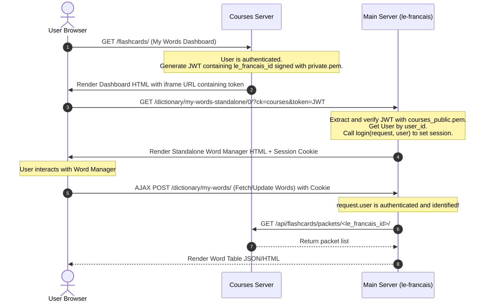

# Token-Based SSO Integration for Standalone Word Manager

## Overview
This specification details the secure token-based Single Sign-On (SSO) integration between `courses.le-francais.ru` (courses server) and `www.le-francais.ru` (main server). It addresses the issue of user identity being `AnonymousUser` inside the iframe standalone word manager, preventing proper loading of courses packets.

## Problem Statement
When a user logs in directly on the `courses` server, they are authenticated on the `courses` backend. However, because the main server's `/api/login/` view merely validates password correctness and returns JSON data, it does not establish a Django session on `www.le-francais.ru`. 

Consequently, when the user visits the standalone word manager iframe hosted on `www.le-francais.ru` via `courses`, their browser requests are treated as anonymous. When `le-francais` attempts to retrieve courses packets via the API with `user.pk` (which is `None`), the request fails to associate with a valid user.

## Design Solution: Token-Based SSO on GET IFrame
We implement a lightweight, secure RS256 token sharing mechanism:
1. **Token Generation on Courses**: When rendering the outer page `my_words` on `courses` (where the user is logged in), the server generates a signed, short-lived JWT containing the user's `le_francais_id`.
2. **URL Propagation**: The generated token is appended to the iframe URL: `/dictionary/my-words-standalone/0/?ck=courses&token=<token>`.
3. **Authentication on Main Server**: Upon handling the `manage_words_standalone` view, `le-francais` extracts and verifies the token using the already-configured `courses_public.pem`.
4. **Session Establishment**: If verified, the user is authenticated on `le-francais` and logged in using `django.contrib.auth.login()`.
5. **Cookie Persistence**: Django sets a session cookie on the user's browser for `www.le-francais.ru`. All subsequent AJAX POST requests and page interactions within the iframe are automatically authenticated and associated with the real user, requiring absolutely zero frontend JavaScript modifications.

## Data Flow

## Security & Performance
* **Encryption**: Uses RS256 algorithm with 2048-bit RSA keys.
* **Expiration**: The token has a short-lived expiration of 15 minutes (`exp` claim) to prevent replay attacks.
* **Database**: Minimal overhead, standard User lookup via primary key.
